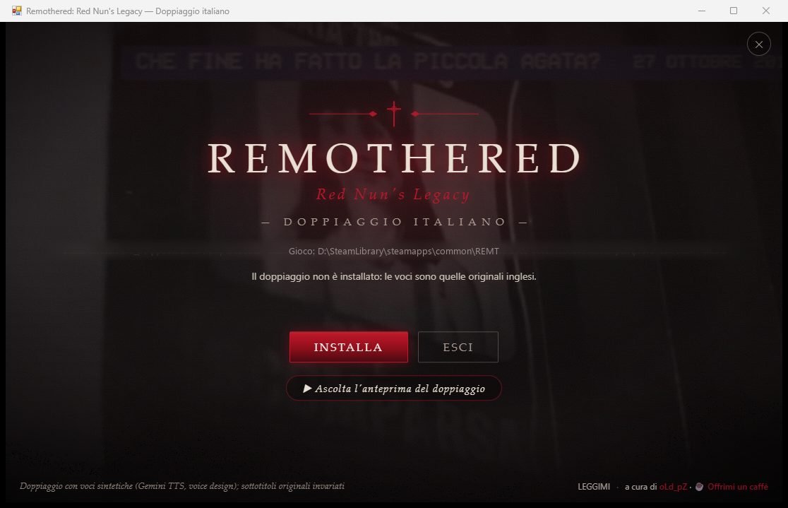

# Remothered: Red Nun's Legacy — doppiaggio italiano

Doppiaggio italiano amatoriale di **Remothered: Red Nun's Legacy** (PC, Steam): tutti i personaggi parlano italiano, **2087 battute** adattate perché ogni frase duri quanto quella inglese e cada sul labiale.

## ⬇️ Download

**[Scarica l'ultima versione](https://github.com/oLdpZ/remothered-doppiaggio-italiano/releases/latest)**: lo zip `REMT-IT-<versione>.zip` è in fondo alla pagina, sotto *Assets*.

- Windows 10/11, Steam Deck e Linux
- Build Steam del gioco: 26220520
- Circa 300 MB liberi sul disco del gioco

## Come è stato fatto

Le voci sono **sintetiche**: generate con un'intelligenza artificiale (Gemini TTS di Google), con una voce disegnata per ogni personaggio, partendo dai sottotitoli italiani ufficiali del gioco. Ogni battuta è stata controllata e sistemata a mano.

- I sottotitoli non cambiano: restano quelli italiani del gioco.
- Urla, gemiti, respiri e pianti restano quelli originali, per scelta.
- Le voci sintetiche hanno dei limiti: qualche intonazione strana, qualche frase un po' accelerata per stare nei tempi.

## Installazione

**Windows:** in Steam, clic destro sul gioco → Gestisci → Sfoglia i file locali. Estrai lo zip lì dentro e fai doppio clic su `REMT-IT\INSTALLA.bat`, poi premi **Installa**. Se Windows mostra "PC protetto da Windows": *Ulteriori informazioni* → *Esegui comunque*.

**Steam Deck / Linux:** in modalità desktop estrai lo zip nella cartella del gioco e fai doppio clic su `REMT-IT/INSTALLA.sh` → *Esegui*.

Nel gioco lascia le voci in inglese (ora parlano italiano) e scegli i sottotitoli in italiano.

Per tornare all'inglese: `DISINSTALLA.bat` / `DISINSTALLA.sh`, oppure da Steam "Verifica l'integrità dei file". Le istruzioni complete sono nel `LEGGIMI.txt` dentro lo zip.

## Cosa c'è nel pacchetto

Nessun file del gioco e nessun programma (niente .exe, niente .dll): solo una patch VCDIFF con la differenza fra il file delle voci originale e quello doppiato (senza il gioco non serve a niente) e degli script di testo leggibili. L'installazione controlla l'impronta del file delle voci prima di toccarlo e mette da parte l'originale.

## Segnalazioni

Apri una [issue](https://github.com/oLdpZ/remothered-doppiaggio-italiano/issues), oppure Discord **oldpz**. Indica dove sei nel gioco, chi parla e cosa dice (il sottotitolo), e cosa non va. Se il problema è l'installazione, allega `REMT-IT\installazione.log`.

## Crediti

Doppiaggio: oLd_pZ · Voci: Gemini TTS (voice design) · Codice scritto con l'aiuto di Claude (Anthropic).

Se ti è piaciuto: [buymeacoffee.com/oldpz](https://buymeacoffee.com/oldpz)

Progetto di un fan, senza legami con gli sviluppatori o con l'editore. Serve una copia originale del gioco. Remothered: Red Nun's Legacy e i suoi marchi appartengono ai rispettivi proprietari.

---

*English: unofficial Italian fan dub (synthetic voices, Gemini TTS) for Remothered: Red Nun's Legacy on Steam. Download the zip from [Releases](https://github.com/oLdpZ/remothered-doppiaggio-italiano/releases/latest), extract it in the game folder and run `INSTALLA.bat` (Windows) or `INSTALLA.sh` (Steam Deck/Linux).*
